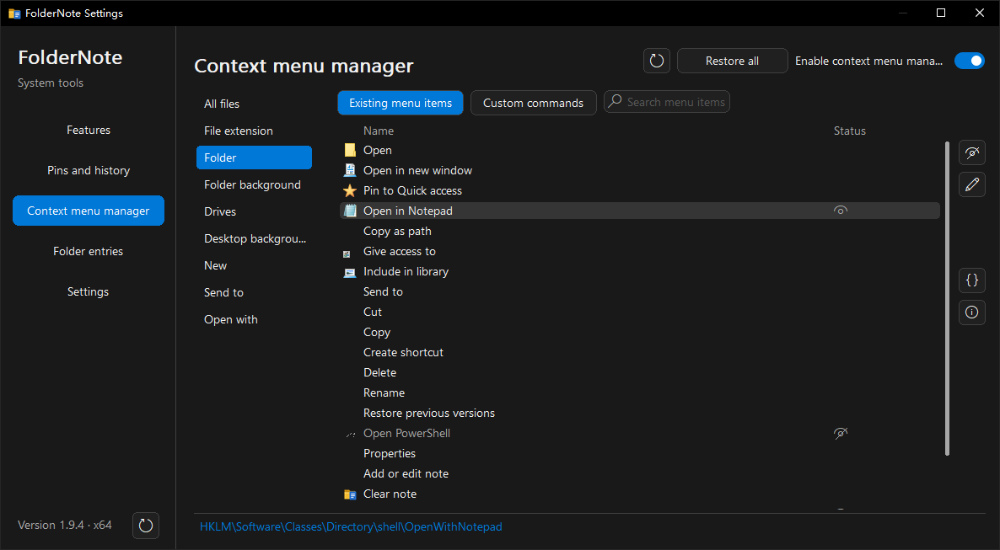
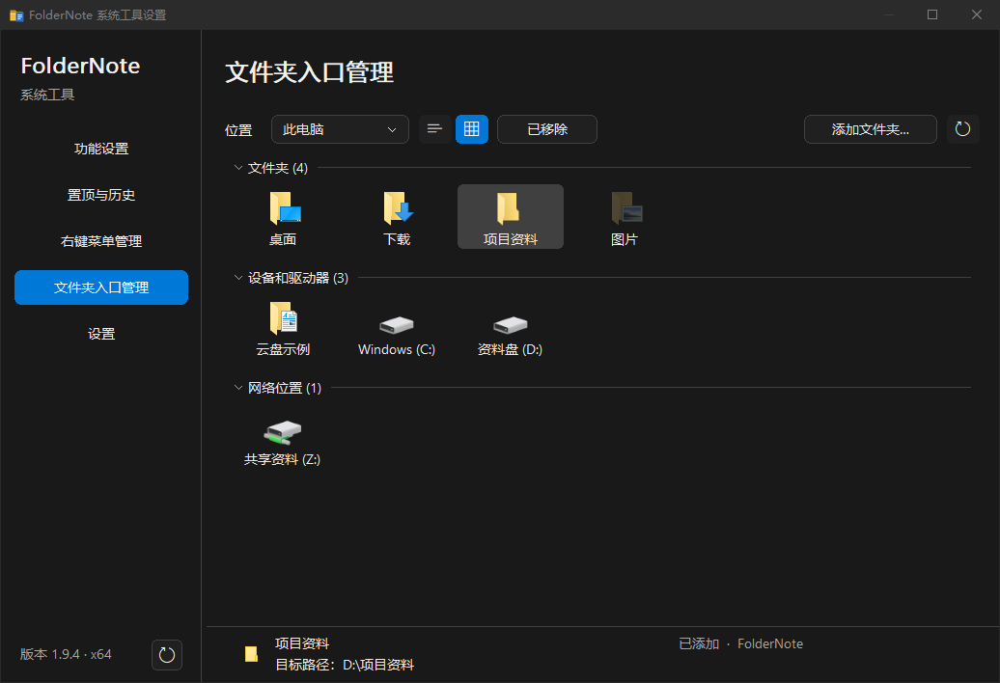

# FolderNote

[简体中文](README.md) · [English](README.en.md)

**Windows File Explorer tools · Version 1.9.4 · x64**

FolderNote adds desktop boxes, folder entry management, context menu management, folder notes, double-click navigation, a middle-click folder menu, and tabs for Windows 10. It uses a native Win32 settings window and requires no separate C++ runtime installation.

[User guide (Chinese)](docs/USER_GUIDE.md) · [Development and builds (Chinese)](docs/DEVELOPMENT.md) · [Changelog (Chinese)](CHANGELOG.md) · [Contributing (Chinese)](CONTRIBUTING.md)

## Interface preview



| Folder entries | Feature settings |
| --- | --- |
|  |  |
| **Pins and history** | **Custom command editor** |
|  |  |

[View Context Menu Manager in Simplified Chinese](docs/previews/settings-zh-CN.png)

## Features

| Feature | How to use it | Default |
| --- | --- | --- |
| Context Menu Manager | Browse existing menus by Explorer object, hide or restore supported entries, and create ordered FolderNote commands. | Off |
| Folder entries | Add folders in This PC, the navigation pane, or the desktop. Hide, show, or restore supported entries, and remove or recover supported This PC entries. | Available in Settings |
| Desktop boxes | Add independent boxes while keeping native Windows icons by default. Icon organization mode is optional. | Off |
| Folder notes | Add, edit, clear, or repair notes from a folder's context menu. Show notes in the Comments column in File Explorer. | Off |
| Double-click empty space | Go up one level or configure the gesture to go back. | Go up one level |
| Middle-click folder menu | Open pinned, recent, and frequently used folders on the desktop or in File Explorer. Hover over folders to browse subfolders. You can also enable the menu in file and folder dialogs. | Off |
| Copy or move by middle click | Select files, middle-click, choose Copy or Move, and select a destination. Windows shows the operation's progress. | Available when the menu opens with items selected |
| Tabs on Windows 10 | Create, duplicate, close, and reopen tabs. Scroll to switch tabs, middle-click to close a tab, or drop files on a tab to transfer them to its folder. | Off |
| Open folders in new tabs | Route new folder windows to tabs in an existing window on Windows 10. A tab's context menu also offers Open in New Window. | Off |
| Appearance | Use a light, dark, or system theme with DPI scaling and the folders' own icons. | Follow system |
| Interface language | Choose Simplified Chinese or English, export a translation template, or import a custom XML language file. | Settings tab |

Windows 11 uses its built-in File Explorer tabs. The Windows 10 option to open folders in tabs opens the first window normally and applies to subsequent folder opens. If an existing window cannot accept the folder, File Explorer opens a separate window.

In a build published on GitHub, choose **Check for Updates** at the bottom left of the settings window. After you confirm, FolderNote downloads and verifies the matching installer package and launches the installer.

## Manage context menus

Choose **Context Menu Manager** in the settings sidebar. Browse menus for files, extensions, folders, folder backgrounds, drives, and the desktop, plus the **New**, **Send to**, and **Open with** submenus. Select a row to view its source. The eye icon hides or restores supported entries.

The status bar shows progress while FolderNote reads menus. Some Windows commands are read-only, including **Restore previous versions** on drives.

Add programs, websites, or CMD and PowerShell commands under **Custom commands**. You can limit commands to a folder or file extension and set their order in the FolderNote submenu. The editor can open the Windows folder and icon pickers. See the [user guide](docs/USER_GUIDE.md#右键菜单管理) for supported changes and how to restore them.

## Manage folder entries

Select **Folder entries** and choose a location. Switch between list and icon views, collapse any of the three **This PC** groups, or select an entry to view its status, source, and target path where available. Select **Add folder…** to add your own folder to the selected location. See the [user guide](docs/USER_GUIDE.md#文件夹入口管理) for the hide, restore, and remove actions.

## Organize the desktop

1. In **Features**, enable **Desktop boxes** and save. By default, Windows continues to manage desktop icons, their positions, and the native context menu. Use **Box appearance** to preview and adjust the corner radius, background opacity, frosted glass, and drop shadow.
2. Right-click an empty area of the desktop and select **New box**. On Windows 11, this command may be under **Show more options**. You can also create boxes from **Manage desktop boxes** or the notification area icon.
3. Drag a desktop item into a box to add a reference. In the default mode, its native icon also appears on the desktop. Drag the item back onto the desktop to remove it from the box. The file stays in its original location.
4. Right-click empty space inside a box to switch between **Icons** and **List**, change the sort order, or adjust **Item spacing**. Use the button on the right side of the title bar to collapse or expand the box. The title menu lets you map a folder, adjust frosted glass and background opacity, and independently choose **Show icon** and **Show text**.
5. Enable **Auto-collapse** in a box's title menu to expand it when you hover over the title and collapse it shortly after the pointer leaves. This option is off by default.
6. To show grouped items only in their boxes, enable **Icon organization mode** under **Features → Desktop boxes** and save. FolderNote reads the positions and sizes of visible Windows desktop icons and shows ungrouped icons in their original layout. You can move icons and save new positions. Right-clicking empty desktop space still opens the native Windows menu. Turn this mode off and save to return to the native Windows icons.

## Install and get started

1. Extract the entire installer archive. Run `Install.exe` for the standard edition or `Install-Win11.exe` for the Windows 11 first-level context menu test edition. Keep the EXE, DLL, and MSIX files together. The first installation may request administrator approval to register the navigation extension.
2. Find **FolderNote** in the Start menu or open `FolderNote.exe`. Use the sidebar to switch between Features, Pins and history, Context Menu Manager, Folder entries, and Settings. The running version appears at the bottom left.
3. Enable the features you want and save. To display notes, add the **Comments** column to File Explorer's Details view.
4. Close and reopen File Explorer windows after installing or upgrading. If Explorer still has the old extension loaded, wait for any file operations to finish before restarting Explorer.

The standard edition uses the folder context menu on Windows 10 and **Show more options** on Windows 11. The [Windows 11 test edition](packaging/README-Win11.md) uses the newer context menu. Windows determines where it appears.

## Translate the interface

1. Open **FolderNote Settings**, select the **Settings** tab and choose English or Simplified Chinese from the **Language** list.
2. To create another language, click **Export language template** or [download the XML template](docs/FolderNote-language.xml). Edit the XML's `name` attribute and translated strings in a text editor. Keep entry IDs and placeholders such as `{0}` intact. Missing entries use English.
3. Save the file as UTF-8 with an `.xml` extension and click **Import language file** to apply the translation.
4. Close and reopen File Explorer windows to see the localized context menus.

## Data and background processes

- Folder notes are stored in each folder's `desktop.ini`. Keep that file when copying folders. Repair can restore missing attributes. To restore deleted note contents, use a backup of the file.
- Notes, visit history, and desktop group layouts stay on your PC. The update check connects to GitHub.
- When desktop boxes are enabled, the desktop helper starts at sign-in and adds a notification area icon. Layouts are saved to `%LOCALAPPDATA%\Programs\FolderNote\DesktopGroups.json`.
- The Explorer extension handles double-click navigation and Windows 10 tabs. A background helper supports the desktop middle-click menu and opening folders in new tabs. The helper exits when both features are off. Support for file and folder dialogs can be switched off separately.
- Upgrades preserve settings, pinned folders, and history. Run `Uninstall.exe` to remove the app. Notes and preferences are retained.

## Build

Install Visual Studio 2022 with Desktop development with C++, a Windows SDK, and CMake 3.24 or later.

Desktop boxes use C++ and WinUI 3 by default. Install Microsoft Windows App Runtime 1.8 from the [Windows App SDK downloads archive](https://learn.microsoft.com/windows/apps/windows-app-sdk/downloads-archive) to use that interface. Desktop boxes use the Win32 interface when the runtime is unavailable.

```powershell
cmake --preset windows-x64
cmake --build --preset release --parallel
ctest --preset release
```

Binaries go to `build/Release/`. Run `packaging/build-release.ps1` after the Release build to create the installer archives. See the [development guide](docs/DEVELOPMENT.md) for release automation and testing.

| Path | Contents |
| --- | --- |
| `src/` | Native app, Shell extensions, navigation, and interface |
| `assets/` | Icons and other app resources |
| `packaging/` | MSIX manifest, package scripts, and Windows 11 installation notes |
| `tests/` | Automated tests and diagnostic utilities |
| `docs/` | User guide, development guide, and interface previews |
| `CMakeLists.txt` | Build targets and app version |
| `CMakePresets.json` | Windows x64 build and test presets |

## Compatibility

FolderNote targets Windows 10 and 11 on x64. The current build passed 27 CTest tests on Windows 10 22H2, covering folder entries, context menus, the settings interface, language selection, folder navigation, and file transfers. The unsigned Windows 11 first-level context menu package is intended for testing. See the [user guide](docs/USER_GUIDE.md) for supported configurations and troubleshooting.
