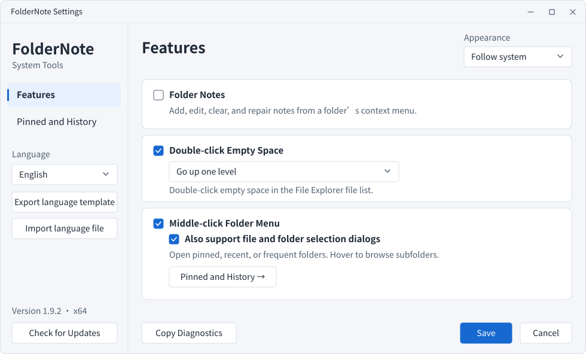

# FolderNote

[简体中文](README.md) · [English](README.en.md)

**Windows File Explorer tools · Version 1.9.2 · x64**

FolderNote adds folder notes, double-click navigation, a middle-click folder menu, and tabs for Windows 10. Each feature has its own switch in a native Win32 settings window. No separate C++ runtime installation is required.

[User guide (Chinese)](docs/USER_GUIDE.md) · [Development and builds (Chinese)](docs/DEVELOPMENT.md) · [Changelog (Chinese)](CHANGELOG.md) · [Contributing (Chinese)](CONTRIBUTING.md)

## Interface preview



Settings illustration · [View the Simplified Chinese interface](docs/previews/settings-zh-CN.svg)

## Features

| Feature | How to use it | Default |
| --- | --- | --- |
| Folder notes | Add, edit, clear, or repair notes from a folder's context menu. Show notes in the Comments column in File Explorer. | Off |
| Double-click empty space | Go up one level or configure the gesture to go back. | Go up one level |
| Middle-click folder menu | Open pinned, recent, and frequently used folders on the desktop or in File Explorer. Hover over folders to browse subfolders. You can also enable the menu in file and folder dialogs. | Off |
| Copy or move by middle click | Select files, middle-click, choose Copy or Move, and select a destination. Windows shows the operation's progress. | Available when the menu opens with items selected |
| Tabs on Windows 10 | Create, duplicate, close, and reopen tabs. Scroll over the tab bar to switch tabs or middle-click a tab to close it. | Off |
| Open folders in new tabs | Route new folder windows to tabs in an existing window on Windows 10. A tab's context menu also offers Open in New Window. | Off |
| Appearance | Use a light, dark, or system theme with DPI scaling and the folders' own icons. | Follow system |
| Interface language | Choose Simplified Chinese or English, export a translation template, or import a custom XML language file. | Switch in the settings sidebar |

Windows 11 uses its built-in File Explorer tabs. The Windows 10 option to open folders in tabs opens the first window normally and applies to subsequent folder opens. If an existing window cannot accept the folder, File Explorer opens a separate window.

In a build published on GitHub, choose **Check for Updates** at the bottom left of the settings window. After you confirm, FolderNote downloads and verifies the matching installer package and launches the installer.

## Install and get started

1. Extract the entire installer archive. Run `Install.exe` for the standard edition or `Install-Win11.exe` for the Windows 11 first-level context menu test edition. Keep the EXE, DLL, and MSIX files together. The first installation may request administrator approval to register the navigation extension.
2. Find **FolderNote** in the Start menu or open `FolderNote.exe`. Use the sidebar to switch between the feature settings and the pinned folders and history page. The running version appears at the bottom left.
3. Enable the features you want and save. To display notes, add the **Comments** column to File Explorer's Details view.
4. Close and reopen File Explorer windows after installing or upgrading. If Explorer still has the old extension loaded, wait for any file operations to finish before restarting Explorer.

The standard edition uses the folder context menu on Windows 10 and **Show more options** on Windows 11. The [Windows 11 test edition](packaging/README-Win11.md) uses the newer context menu. Windows determines where it appears.

## Translate the interface

1. Open **FolderNote settings** and choose English or Simplified Chinese from the **Language** list in the sidebar.
2. To create another language, click **Export language template** or [download the XML template](docs/FolderNote-language.xml). Edit the XML's `name` attribute and translated strings in a text editor. Keep entry IDs and placeholders such as `{0}` intact. Missing entries use English.
3. Save the file as UTF-8 with an `.xml` extension and click **Import language file** to apply the translation.
4. Close and reopen File Explorer windows to see the localized context menus.

## Data and background processes

- Folder notes are stored in each folder's `desktop.ini`. Keep that file when copying folders. Repair can restore missing attributes. To restore deleted note contents, use a backup of the file.
- Notes and visit history stay on your PC. The update check connects to GitHub. FolderNote has no notification-area icon.
- The Explorer extension handles double-click navigation and Windows 10 tabs. A background helper supports the desktop middle-click menu and opening folders in new tabs. The helper exits when both features are off. Support for file and folder dialogs can be switched off separately.
- Upgrades preserve settings, pinned folders, and history. Run `Uninstall.exe` to remove the app. Notes and preferences are retained.

## Build

Install Visual Studio 2022 with Desktop development with C++, a Windows SDK, and CMake 3.24 or later.

```powershell
cmake --preset windows-x64
cmake --build --preset release --parallel
ctest --preset release
```

Binaries go to `build/Release/`. Run `packaging/build-release.ps1` after the Release build to create the installer archives. See the [development guide](docs/DEVELOPMENT.md) for release automation and testing.

| Path | Contents |
| --- | --- |
| `src/` | Native app, Shell extensions, navigation, and interface |
| `assets/` | Icons and other app resources |
| `packaging/` | MSIX manifest, package scripts, and Windows 11 installation notes |
| `tests/` | Automated tests and diagnostic utilities |
| `docs/` | User guide, development guide, and interface previews |
| `CMakeLists.txt` | Build targets and app version |
| `CMakePresets.json` | Windows x64 build and test presets |

## Compatibility

FolderNote targets Windows 10 and 11 on x64. Automated tests exercise folder navigation, the middle-click menu, folder selection, and copy and move operations. The unsigned Windows 11 first-level context menu package is intended for testing. See the [user guide](docs/USER_GUIDE.md) for supported configurations and troubleshooting.
