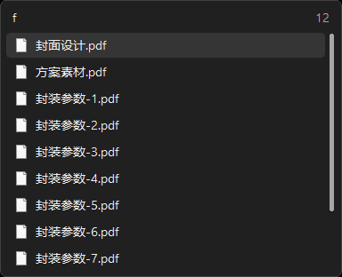
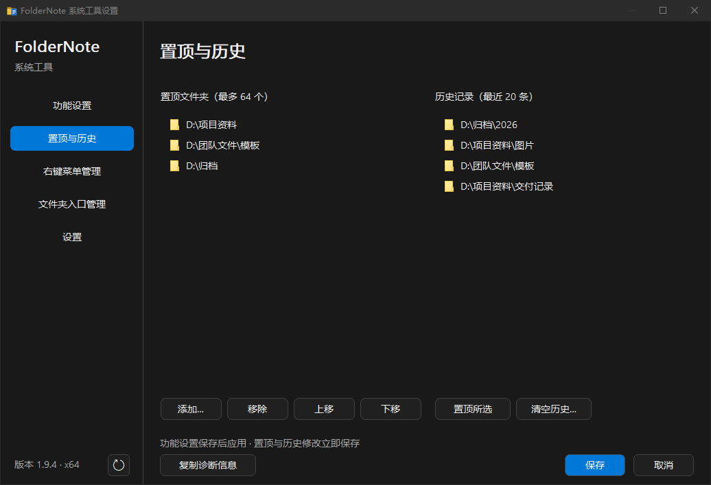

<p align="center">
  
</p>
<h1 align="center">FolderNote</h1>
<p align="center"><strong>Organize your desktop. Find files faster. Make Explorer work your way.</strong></p>
<p align="center">Desktop boxes · Chinese initials search · Middle-click menu · Folder notes</p>
<p align="center">
  <a href="https://github.com/Wonvy/FolderNote/releases/latest"></a>
  
  <a href="https://github.com/Wonvy/FolderNote/actions/workflows/windows-release.yml"></a>
</p>
<p align="center">
  <a href="README.md">简体中文</a> · <strong>English</strong><br>
  <a href="https://github.com/Wonvy/FolderNote/releases/latest">Download</a> ·
  <a href="docs/USER_GUIDE.md">User guide (中文)</a> ·
  <a href="CHANGELOG.md">Changelog (中文)</a> ·
  <a href="https://github.com/Wonvy/FolderNote/issues">Report an issue</a>
</p>

---

FolderNote adds tools to Windows File Explorer. Collect desktop files into boxes, find items by typing a few letters, and return to favorite folders with the middle-click menu. Enable folder notes, menu management, and Windows 10 tabs as needed, all from one settings window.

## Download and get started

| Installer | Choose this for |
| --- | --- |
| **[Download the standard installer](https://github.com/Wonvy/FolderNote/releases/latest/download/FolderNote-Setup-x64.exe)** | Windows 10 / 11 x64. On Win11, folder note commands appear under **Show more options** |
| [Download the Win11 first-level menu test edition](https://github.com/Wonvy/FolderNote/releases/latest/download/FolderNote-Setup-Win11-x64.exe) | Folder note commands in the new Win11 menu's app area. See the [test edition guide](packaging/README-Win11.md) |

1. **Install**: run the single EXE. No extraction is needed; follow the installer prompts.
2. **Configure**: search the Start menu for **FolderNote Settings**, enable the features you want, and save.
3. **Start using it**: reopen your Explorer windows. To search from the desktop, enable **Desktop and File Explorer** on the **Quick search** page.

> On a fresh install, double-clicking empty space goes up one folder. Boxes, notes, the middle-click menu, and tabs are opt-in. Upgrades preserve existing settings and data. Uninstall through Windows **Installed apps**.

**Already installed?** Choose **Check for updates** at the bottom left of Settings. You can also enable **Automatic updates** in Preferences: opening Settings checks at most once a day, and the standard edition can install updates that need no administrator approval. Downloads are checked against SHA-256. See [update details](docs/USER_GUIDE.md#检查更新与自动更新).

## Features

| Feature and guide | What it does |
| --- | --- |
| **[Desktop boxes](docs/USER_GUIDE.md#桌面盒子)** | Drag and drop, tabs, mapped folders, icon/list views, pages, and folding; color, opacity, and blur per box |
| **[Chinese initials search](docs/USER_GUIDE.md#中文首字母快速定位)** | Candidates near the pointer in boxes, app lists, the desktop, Explorer, and standard file dialogs; choose to select or open |
| **[Middle-click menu](docs/USER_GUIDE.md#中键快速定位)** | Pinned, recent, and frequent folders and subfolders; copy or move selected items |
| **[Context menu management](docs/USER_GUIDE.md#右键菜单管理)** | Inspect, hide, and restore supported entries; add programs, websites, CMD, or PowerShell commands |
| **[Folder entry management](docs/USER_GUIDE.md#文件夹入口管理)** | Add and manage supported entries in This PC, the navigation pane, and the desktop |
| **[Folder notes](docs/USER_GUIDE.md#文件夹备注)** | Add, edit, clear, or repair notes and show them in Explorer's Comments column |
| **[Double-click navigation](docs/USER_GUIDE.md#双击空白处导航)** | Double-click empty space in a file list to go up one level or back |
| **[Windows 10 tabs](docs/USER_GUIDE.md#windows-10-多标签)** | Create, duplicate, and reopen tabs; scroll to switch, middle-click to close, drop files onto tabs, and route folder opens to an existing window |

### Organized files, clear locations

Windows continues to manage the native desktop icons and context menu. Dropping desktop files into a regular box moves them into **`FolderNote Boxes`** on your personal desktop. Drag them back or choose **Remove from box** to return them to the desktop. Mapped folders show their contents in the original location.

Boxes have no separate taskbar buttons or tray icon and remain available when you use Win+D. Image thumbnails keep their full aspect ratio; **Ctrl + mouse wheel** changes icon size. With Seer running, select a file and press **Space** to preview it.

Right-click a box title to customize its appearance. Enable frosted glass, then use the **Blur strength** slider from **0–100%**. Each box saves its own setting.

### Type a few letters, then choose a result

| Type | Example matches |
| --- | --- |
| `sc` | 素材, with English matches such as `ScriptData` also listed |
| `sjsc` | 设计素材 or 設計素材 |
| `cqxm` | 重庆项目 |
| `pssj2026` | PS设计_2026.png |

Candidates show native Windows icons. Click a result or choose it with the arrow keys and Enter. By default, **folders open and files are selected**; change these separately on the **Quick search** page. The menu fits its results and shows a scrollbar only when needed.

**Desktop search includes files inside boxes.** Click empty desktop space and type. Results identify the box and tab; choosing one expands the box, switches tabs, and selects the correct page. Matching stays local and does not build a whole-disk index.

| Light candidate menu | Dark candidate menu |
| :---: | :---: |
|  |  |

<sub>Example filenames rendered by the current version's actual candidate control.</sub>

## Interface preview


<details>
<summary><strong>More previews: folder entries, pins and history, custom commands</strong></summary>

| Folder entries | Pins and history |
| :---: | :---: |
|  |  |


These screenshots illustrate the page layouts; available options follow the current version.

</details>

## What's new in v1.9.10

- **Search box contents from the desktop**: includes other tabs and direct children of mapped folders, identifies each source, keeps same-name items separate, and respects your select/open preference.
- **Correct Seer preview selection**: releasing Space inside a box previews its selected file. Changing focus or selection cancels a stale request.

Automated build and release completed. Published installers passed version, SHA-256, embedded-file, and application-icon checks. [Full changelog →](CHANGELOG.md)

## Compatibility and data

| Item | Details |
| --- | --- |
| Windows | Windows 10 / 11 **x64**; no ARM64 package. The main hands-on validation environment is Windows 10 22H2 |
| Tabs | FolderNote's tab bar is for Windows 10; Windows 11 uses its built-in tabs |
| Desktop UI | WinUI 3 requires Microsoft Windows App Runtime 1.8. Boxes fall back to Win32 if it is missing. [Runtime downloads](https://learn.microsoft.com/windows/apps/windows-app-sdk/downloads-archive) |
| File locations | Regular boxes store files in the desktop's `FolderNote Boxes` folder. Mapped files stay in place. Notes are stored in each folder's `desktop.ini` |
| Local data | Settings, pins, history, and box layouts stay on the computer. Update checks connect to GitHub |
| Installation | Single EXE installers use the app icon. Upgrades and removal preserve user files and notes. Packages are currently unsigned; the Win11 first-level menu edition is for testing |

See the [user guide](docs/USER_GUIDE.md) for dialog support, wallpaper-based blur, and reopening old Explorer windows after an upgrade.

## Documentation and development

| Document | Contents |
| --- | --- |
| [User guide (中文)](docs/USER_GUIDE.md) | Installation, features, operation reference, data locations, and troubleshooting |
| [Development guide (中文)](docs/DEVELOPMENT.md) | Builds, modules, tests, installers, and automated releases |
| [Changelog (中文)](CHANGELOG.md) | Features and fixes by version |
| [Contributing (中文)](CONTRIBUTING.md) | Issue reports, contribution workflow, and validation |
| [Language template](docs/FolderNote-language.xml) | Simplified Chinese and English are built in; custom XML translations can be imported |

Requires Visual Studio 2022 C++ desktop tools, Windows SDK, and CMake 3.24+:

```powershell
cmake --preset windows-x64
cmake --build --preset release --parallel
ctest --preset release
```

Built with C++20, Win32, and WinUI 3. Output is in `build/Release/`. [Build and release details →](docs/DEVELOPMENT.md)
