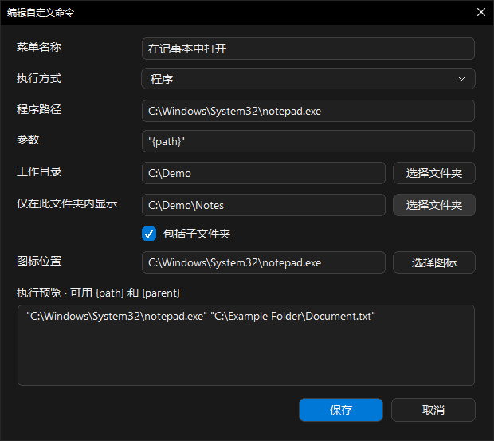

# FolderNote

[简体中文](README.md) · [English](README.en.md)

**Windows 资源管理器增强工具 · 当前版本 1.9.4 · x64**

FolderNote 把桌面盒子、文件夹入口管理、右键菜单管理、文件夹备注、双击空白处导航、中键快速定位和 Windows 10 多标签集中在一个设置窗口中。程序使用 C++20，设置窗口使用 Win32，桌面盒子的文件视图使用 WinUI 3。

[软件使用说明](docs/USER_GUIDE.md) · [开发与构建](docs/DEVELOPMENT.md) · [版本记录](CHANGELOG.md) · [贡献说明](CONTRIBUTING.md)

## 界面预览


| 功能设置 | 右键菜单管理 |
| --- | --- |
|  |  |
| **置顶与历史** | **编辑自定义命令** |
|  |  |

[查看英文界面](docs/previews/settings-en-US.png)

## 功能

| 功能 | 使用方式 | 首次安装默认 |
| --- | --- | --- |
| 右键菜单管理 | 按资源管理器对象查看现有菜单，隐藏或还原支持的项目，并创建可排序的 FolderNote 自定义命令 | 关闭 |
| 文件夹入口管理 | 在此电脑、左侧导航栏和桌面添加文件夹，隐藏、显示或还原受支持的入口。在此电脑可移除并恢复现有入口 | 随设置页提供 |
| 桌面盒子 | 在“功能”页预览毛玻璃效果，启用并保存后，通过盒子和“待整理桌面”管理桌面图标。关闭并保存可恢复 Windows 原有的桌面图标 | 关闭 |
| 文件夹备注 | 在文件夹右键菜单添加、编辑、清除或批量修复备注，资源管理器“备注”列显示 | 关闭 |
| 双击空白处导航 | 返回上一级文件夹，也可改为后退 | 返回上一级 |
| 中键快速定位 | 桌面与资源管理器中使用置顶、最近访问、最多访问和悬停子菜单，可选支持打开 / 保存及浏览文件夹对话框 | 关闭 |
| 中键复制 / 移动 | 选中项目后按中键（空白处也可），点击“复制”或“移动”并选择目标目录，使用 Windows 系统进度窗口 | 有选择时随中键菜单提供，无单独开关 |
| Win10 多标签 | 新建、复制、关闭和恢复标签，可通过滚轮切换、中键关闭，并将文件拖入其他标签对应的文件夹 | 关闭 |
| 始终在新标签中打开 | Win10 多标签子选项；桌面双击或其他软件打开目录时优先使用已有窗口的新标签，标签右键可指定新窗口 | 关闭 |
| 外观主题 | 浅色、深色或跟随系统，支持 DPI 缩放和文件夹自身图标 | 跟随系统 |
| 界面语言 | 内置简体中文和 English，支持导出翻译模板和导入自定义 XML 语言文件 | 在「设置」选项卡切换 |

**始终在新标签中打开文件夹**位于 Win10 多标签开关下。首个窗口正常打开，启用前已打开的窗口保持不变；扩展在创建阶段暂缓新窗口显示，将目录交给已有窗口的新标签，确认加载后完成交接。没有可用窗口、加载失败或超时则正常显示来源窗口。标签右键的 **在新窗口打开** 始终另开窗口。

GitHub 发布版可在设置窗口左下角检查更新。用户确认后自动下载并校验安装包，再启动安装器。仓库配置和发布步骤见[开发说明](docs/DEVELOPMENT.md#首次发布到-github)。

## 管理右键菜单

在设置窗口左侧选择 **右键菜单管理**，按文件、扩展名、文件夹、文件夹空白处、驱动器或桌面查看菜单。也可浏览 **新建**、**发送到** 和 **打开方式** 子菜单。选中条目即可查看注册来源，点击眼睛可隐藏或恢复支持的项目。

读取菜单时，窗口底部会显示进度信息。部分 Windows 原生命令仅供查看，例如驱动器菜单的 **还原以前的版本**。

在 **自定义命令** 中添加程序、网址、CMD 或 PowerShell 命令，可限定目录和扩展名，并调整 FolderNote 子菜单内的顺序。编辑时可打开系统文件夹与图标选择窗口。有关支持范围和恢复方法，见[右键菜单管理使用说明](docs/USER_GUIDE.md#右键菜单管理)。

## 管理文件夹入口

在 **文件夹入口管理** 中选择位置，可切换列表和图标视图，点箭头折叠「此电脑」的 **文件夹**、**设备和驱动器** 与 **网络位置**。选中条目后，底部状态栏显示可取得的目标路径、状态和来源。点击 **添加文件夹…** 可在所选位置添加自己的入口。隐藏、还原和移除的区别见[文件夹入口管理使用说明](docs/USER_GUIDE.md#文件夹入口管理)。

## 整理桌面

1. 在 **功能设置** 中开启 **桌面盒子** 并保存。FolderNote 接管桌面图标，未分组的文件和文件夹显示在 **待整理桌面**。毛玻璃默认开启。在 **盒子样式** 中可以预览并调整圆角、背景不透明度、毛玻璃和投影。
2. 在桌面空白处右键选择 **新建盒子**，或长按右键后松开。Windows 11 的右键菜单入口可能位于 **显示更多选项**。也可以通过设置中的 **管理桌面盒子** 或通知区域图标创建。
3. 把项目拖入盒子，或在盒子之间拖动。在盒子内空白处右键，可切换 **图标** 和 **列表**，也可按手动、名称、类型或修改时间排序。盒子可折叠，并可添加标签或映射文件夹。映射标签显示对应文件夹的内容。
4. 关闭 **桌面盒子** 并保存可恢复 Windows 原有的桌面图标。分组操作保留文件原有位置。

## 安装和开始使用

1. 完整解压安装包。通用版运行 `Install.exe`；Win11 首层菜单测试版运行 `Install-Win11.exe`，保留包内所有 EXE、DLL 和 MSIX 文件。首次注册导航自动加载入口可能需要管理员授权。
2. 从开始菜单搜索 **FolderNote 设置**，或双击 `FolderNote.exe`。从左侧切换功能、置顶与历史、右键菜单管理、文件夹入口管理和设置，左下角查看当前版本。
3. 按需开启功能并保存。需要显示备注时，在资源管理器“详细信息”视图的列标题菜单中添加“备注”列。
4. 安装或升级后重新打开文件夹窗口。仍使用旧扩展的进程可能需要在文件复制 / 移动结束后重启资源管理器；安装器不会强制重启桌面。

通用版菜单在 Win10 中直接显示，在 Win11 中位于“显示更多选项”。[Win11 首层菜单测试版](packaging/README-Win11.md)使用新版菜单的应用区域，具体排序由系统决定，不能保证固定在“属性”下面。

## 翻译界面

1. 打开 **FolderNote 设置**，进入左侧 **设置**，在 **界面语言** 下拉框选择简体中文或 English。
2. 要制作其他语言，请在设置中点击 **导出语言模板**，或[下载 XML 模板](docs/FolderNote-language.xml)。用文本编辑器修改 `name` 属性和各条译文。保留条目的 `id` 和 `{0}` 等占位符。省略的条目会显示英文。
3. 将文件保存为 UTF-8 编码的 `.xml`，点击 **导入语言文件** 应用译文。
4. 重新打开文件夹窗口以查看切换语言后的资源管理器菜单。

## 数据与运行方式

- 备注保存在文件夹自己的 `desktop.ini` 中；复制时需要连同该文件一起保留。属性丢失可批量修复，备注文件被删除后无法仅靠修复找回内容。
- 备注、访问记录和桌面盒子布局保存在本机。检查更新时连接 GitHub。
- 启用桌面盒子后，桌面组件随登录启动，并在通知区域提供入口。布局保存在 `%LOCALAPPDATA%\Programs\FolderNote\DesktopGroups.json`。桌面组件意外退出时，恢复程序会还原原来的图标可见状态。
- 双击导航和 Win10 多标签由已有扩展处理。启用“中键快速定位”后，会运行随登录启动的小型组件以支持桌面；“始终在新标签中打开文件夹”也复用该组件，两项均停用后退出。文件选择对话框支持仍可单独关闭；桌面菜单默认另开窗口，启用新标签选项后优先使用已有窗口的新标签。
- 覆盖升级保留设置、置顶和历史。卸载使用 `Uninstall.exe`，不删除用户文件夹里的备注；设置和访问记录也保留。

完整操作、快捷键、适用范围和故障排查见[软件使用说明](docs/USER_GUIDE.md)。

## 构建

需要 Windows、Visual Studio 2022 的 C++ 桌面开发工具、Windows SDK，以及 CMake 3.24 或更新版本。

桌面盒子默认使用 C++ / WinUI 3。运行时需要 Microsoft Windows App Runtime 1.8，可从微软的 [Windows App SDK 下载存档](https://learn.microsoft.com/windows/apps/windows-app-sdk/downloads-archive)安装。缺少运行时时，盒子会使用 Win32 界面。

```powershell
cmake --preset windows-x64
cmake --build --preset release --parallel
ctest --preset release
```

构建输出位于 `build/Release/`。安装包生成、模块结构和测试约定见[开发指南](docs/DEVELOPMENT.md)。

## 项目结构

```text
src/            原生程序、Shell 扩展、导航与界面
assets/         图标源文件与资源
packaging/      Win11 清单、打包脚本和安装说明
tests/          自动测试与开发诊断工具
docs/           用户说明与开发指南
CMakeLists.txt  构建目标与统一版本号
CMakePresets.json  Windows x64 构建和测试预设
CHANGELOG.md    版本记录
```

`build/`、`dist/`、本机 IDE 配置及 `desktop.ini` 不提交到 Git。

## 验证状态

支持目标为 Windows 10/11 x64。当前构建在 Windows 10 22H2 通过 27 项 CTest，涵盖文件夹入口、右键菜单、设置界面、语言切换、文件夹导航和复制 / 移动。当前安装包未签名，Win11 首层菜单包用于测试。
