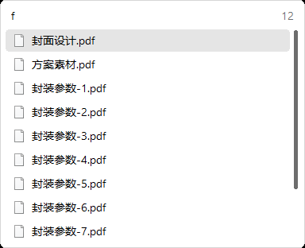
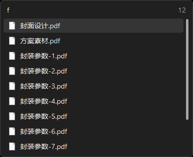
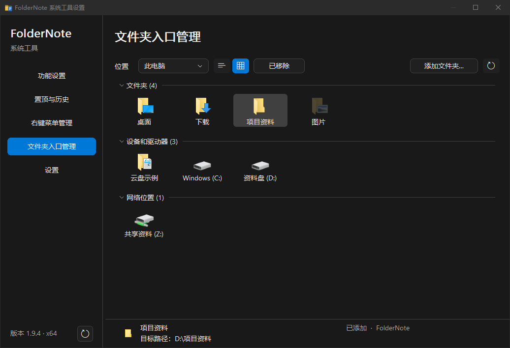
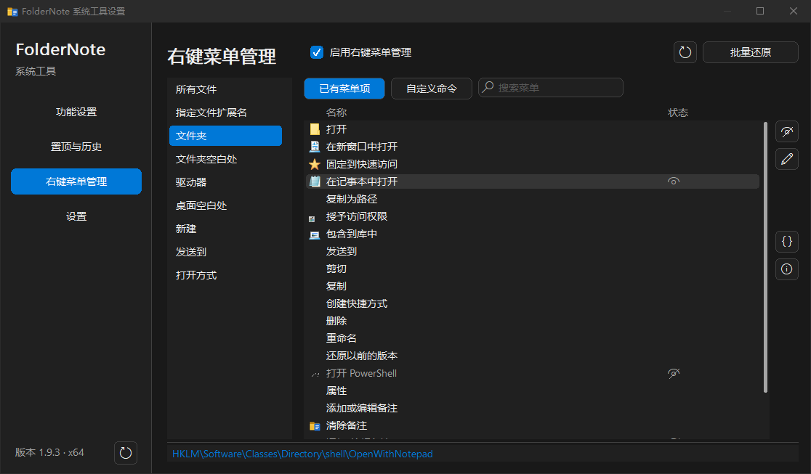
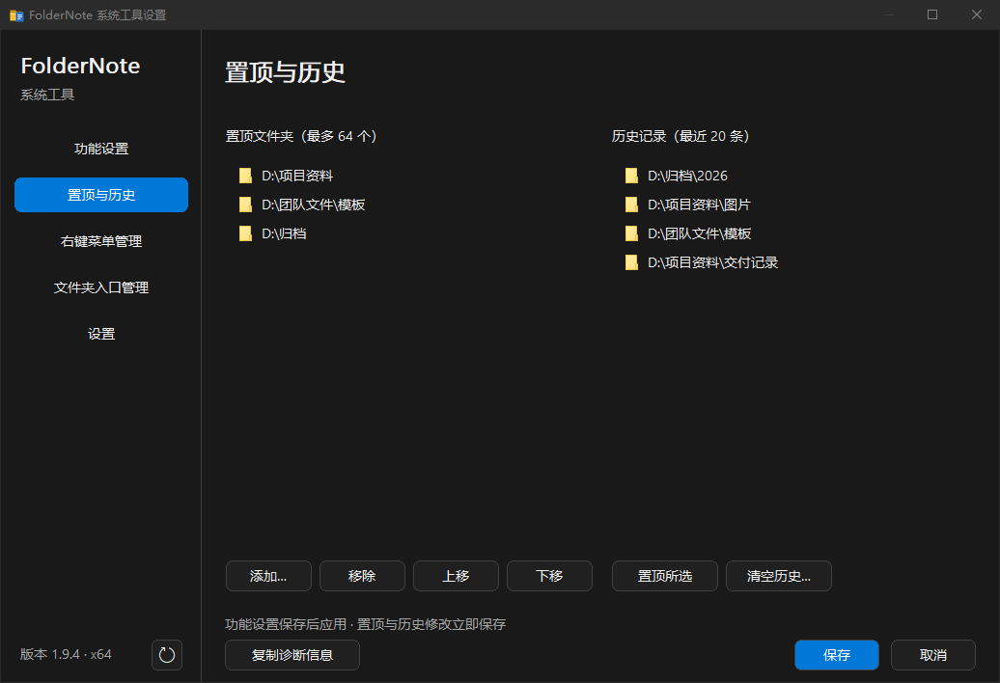

<p align="center">
  
</p>
<h1 align="center">FolderNote</h1>
<p align="center"><strong>整理桌面，快速找文件，让资源管理器更顺手。</strong></p>
<p align="center">桌面盒子 · 首字母搜索 · 中键菜单 · 文件夹备注</p>
<p align="center">
  <a href="https://github.com/Wonvy/FolderNote/releases/latest"></a>
  
  <a href="https://github.com/Wonvy/FolderNote/actions/workflows/windows-release.yml"></a>
</p>
<p align="center">
  <strong>简体中文</strong> · <a href="README.en.md">English</a><br>
  <a href="https://github.com/Wonvy/FolderNote/releases/latest">下载最新版</a> ·
  <a href="docs/USER_GUIDE.md">功能与使用说明</a> ·
  <a href="CHANGELOG.md">更新记录</a> ·
  <a href="https://github.com/Wonvy/FolderNote/issues">反馈问题</a>
</p>

---

FolderNote 是一款 Windows 资源管理器增强工具。把散落的桌面文件收进盒子，用几个首字母找到项目，在中键菜单里回到常用目录，再按需要开启备注、菜单管理和 Windows 10 多标签。所有功能集中在同一个设置窗口中。

## 下载与开始使用

| 安装包 | 适用场景 |
| --- | --- |
| **[下载通用安装包](https://github.com/Wonvy/FolderNote/releases/latest/download/FolderNote-Setup-x64.exe)** | Windows 10 / 11 x64；Win11 的备注命令位于「显示更多选项」 |
| [下载 Win11 首层菜单测试版](https://github.com/Wonvy/FolderNote/releases/latest/download/FolderNote-Setup-Win11-x64.exe) | 将备注命令放入 Win11 新版菜单的应用区域；详见[测试版说明](packaging/README-Win11.md) |

1. **安装**：运行下载的单个 EXE，无需解压；按提示完成授权。
2. **设置**：在开始菜单搜索 **FolderNote 设置**，按需开启功能并保存。
3. **使用**：重新打开文件夹窗口；要在桌面输入首字母搜索，请到 **快捷搜索** 页开启 **桌面与资源管理器**。

> 首次安装默认开启双击空白处返回上一级；盒子、备注、中键菜单、多标签等按需开启。覆盖升级保留已有设置和数据，可从 Windows「已安装的应用」卸载。

**已有用户**：在设置左下角点击 **检查更新**。也可在偏好设置开启 **自动更新**，打开设置时每天最多自动检查一次；通用版可自动安装无需管理员授权的更新。安装前校验 SHA-256。详见[更新说明](docs/USER_GUIDE.md#检查更新与自动更新)。

## 核心功能

| 功能与操作说明 | 能做什么 |
| --- | --- |
| **[桌面盒子](docs/USER_GUIDE.md#桌面盒子)** | 拖放收纳、多标签与文件夹映射；图标／列表、分页、折叠；各盒子独立调整颜色、透明度与模糊强度 |
| **[中文首字母搜索](docs/USER_GUIDE.md#中文首字母快速定位)** | 鼠标旁显示候选；覆盖盒子、软件列表、原生桌面、资源管理器及标准文件窗口；可选定位或打开 |
| **[中键快捷菜单](docs/USER_GUIDE.md#中键快速定位)** | 置顶、最近访问、最多访问与子文件夹导航；复制或移动所选项目 |
| **[右键菜单管理](docs/USER_GUIDE.md#右键菜单管理)** | 查看、隐藏和还原支持的菜单项，添加程序、网址、CMD 或 PowerShell 命令 |
| **[文件夹入口管理](docs/USER_GUIDE.md#文件夹入口管理)** | 管理「此电脑」、导航栏与桌面的文件夹入口，添加、隐藏、还原或移除支持的入口 |
| **[文件夹备注](docs/USER_GUIDE.md#文件夹备注)** | 添加、编辑、清除与批量修复备注，在资源管理器「备注」列查看 |
| **[双击空白处导航](docs/USER_GUIDE.md#双击空白处导航)** | 双击文件列表空白处，返回上一级或后退到上次位置 |
| **[Windows 10 多标签](docs/USER_GUIDE.md#windows-10-多标签)** | 新建、复制、恢复标签；滚轮切换、中键关闭、拖入文件；可优先在已有窗口新标签中打开目录 |

### 桌面整洁，文件位置清楚

Windows 继续管理原生桌面图标和右键菜单。将桌面文件拖入普通盒子后，文件会移到个人桌面的隐藏目录 **`.desktop`**；拖回桌面或选择 **移出盒子** 即可还原到桌面。映射文件夹则显示原目录内容。

盒子不占任务栏按钮，也不显示托盘图标。支持 Win＋D 返回桌面；图片缩略图按原比例完整显示，**Ctrl＋滚轮** 调整图标大小。运行 Seer 时，选中文件后按 **空格** 可预览。

右键盒子标题可调整外观。开启毛玻璃后，使用 **模糊强度** 滑块在 **0–100%** 间调整，每个盒子独立保存。

### 输入几个字母，选择想要的项目

| 输入 | 示例匹配 |
| --- | --- |
| `sc` | 素材；同时保留 `ScriptData` 等英文匹配 |
| `sjsc` | 设计素材、設計素材 |
| `cqxm` | 重庆项目 |
| `pssj2026` | PS设计_2026.png |

候选支持 Windows 原生图标、点击选择、方向键和 Enter 确认。默认**文件夹打开、文件选中**，可在独立的 **快捷搜索** 页修改。菜单高度随结果数量变化，仅溢出时显示滚动条。

**在桌面也能找到盒子里的文件。** 先点击桌面空白处，再输入首字母；候选会标明所属盒子和标签，选中后自动展开盒子、切换标签并定位到对应页。搜索使用本地名称匹配，不建立全盘索引。

| 浅色候选菜单 | 深色候选菜单 |
| :---: | :---: |
|  |  |

<sub>使用示例文件名，由当前版本的真实候选控件渲染。</sub>

## 界面预览



<details>
<summary><strong>展开查看：右键菜单、置顶与历史、自定义命令</strong></summary>

| 右键菜单管理 | 置顶与历史 |
| :---: | :---: |
|  |  |


[查看英文界面](docs/previews/settings-en-US.png)。截图用于展示页面布局，完整选项以当前版本为准。

</details>

## v1.9.13 更新

- **桌面收纳目录统一为隐藏 `.desktop`**：普通盒子收纳目录改为个人桌面下的隐藏目录 `.desktop`，保持桌面干净并避免误删收纳文件夹。
- **鼠标中键菜单常驻自愈与防抖优化**：优化低级鼠标钩子热路径防止超时摘钩，新增定时无感重挂及睡眠唤醒／锁屏／UAC 切回即时自愈、后台进程巡检守护与盒内中键双保险；放宽滚轮按压手抖容差并忽略按压期间轻微滚轮滚动干扰。

本版已完成自动构建与发布，独立安装包通过版本、SHA-256、内置文件和软件图标校验。[查看完整更新记录 →](CHANGELOG.md)

## 兼容性与数据

| 项目 | 说明 |
| --- | --- |
| 系统 | Windows 10 / 11 **x64**；不提供 ARM64 包。主要实机验证环境为 Windows 10 22H2 |
| 标签 | FolderNote 自带标签栏仅用于 Windows 10；Windows 11 使用系统原生标签 |
| 桌面界面 | WinUI 3 界面需要 Microsoft Windows App Runtime 1.8；缺少运行时时回退到 Win32 界面。[运行时下载](https://learn.microsoft.com/windows/apps/windows-app-sdk/downloads-archive) |
| 文件位置 | 普通盒子收纳在个人桌面的隐藏目录 `.desktop`；映射目录内容仍在原位置；备注写入对应文件夹的 `desktop.ini` |
| 本地数据 | 设置、置顶、访问历史与盒子布局保存在本机；检查更新时连接 GitHub |
| 安装与卸载 | 独立 EXE 使用软件图标；覆盖升级和卸载均保留用户文件与备注。当前安装包未签名，Win11 首层菜单版用于测试 |

标准文件窗口支持范围、动态壁纸下的毛玻璃效果，以及升级后的旧窗口处理方式，见[功能与使用说明](docs/USER_GUIDE.md)。

## 文档与开发

| 文档 | 内容 |
| --- | --- |
| [功能与使用说明](docs/USER_GUIDE.md) | 安装、功能设置、操作速查、数据位置与常见问题 |
| [开发指南](docs/DEVELOPMENT.md) | 构建、模块结构、测试、安装包与自动发布 |
| [版本记录](CHANGELOG.md) | 各版本的功能与修复 |
| [参与开发](CONTRIBUTING.md) | 问题反馈、修改流程与验证要求 |
| [语言模板](docs/FolderNote-language.xml) | 内置简体中文和 English，也可导入自定义 XML 翻译 |

需要 Visual Studio 2022 的 C++ 桌面开发工具、Windows SDK 和 CMake 3.24+：

```powershell
cmake --preset windows-x64
cmake --build --preset release --parallel
ctest --preset release
```

程序使用 C++20、Win32 与 WinUI 3，构建输出位于 `build/Release/`。[查看构建与发布说明 →](docs/DEVELOPMENT.md)
