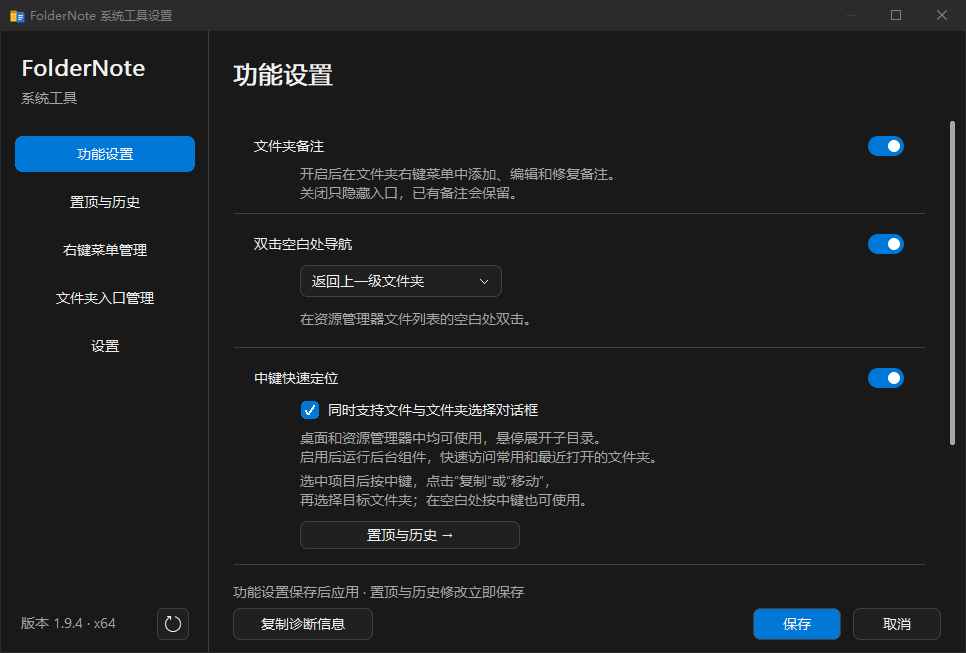
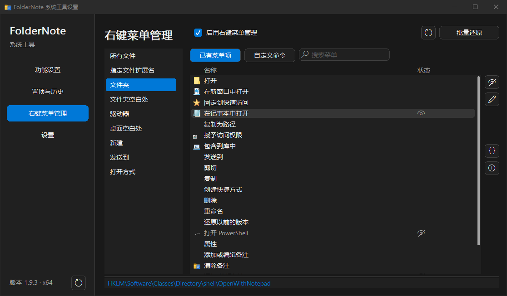
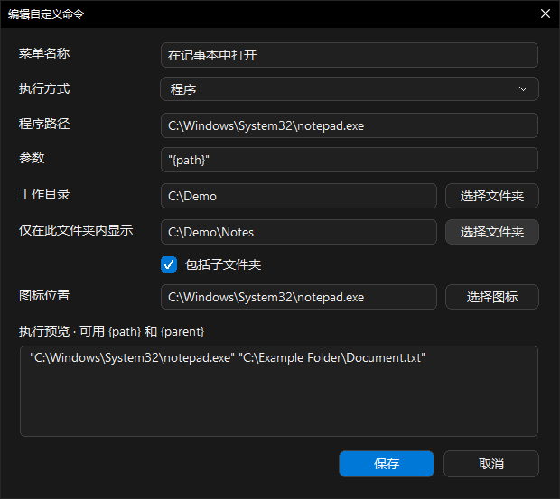
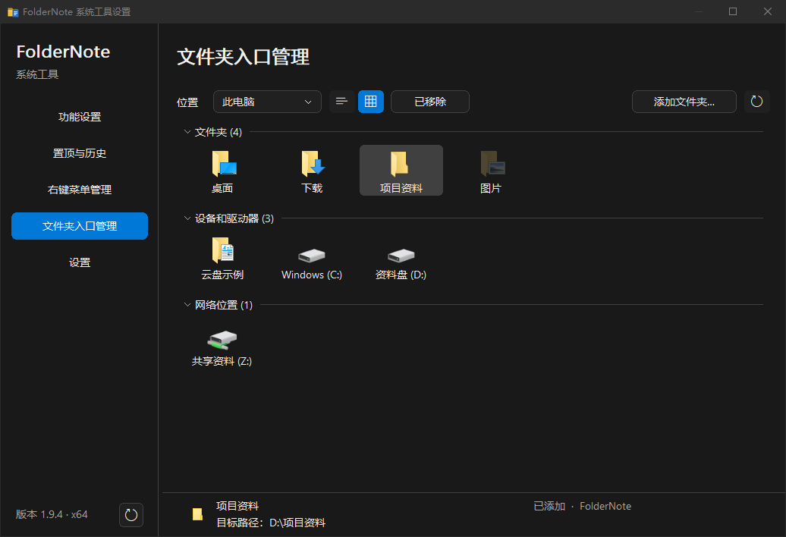
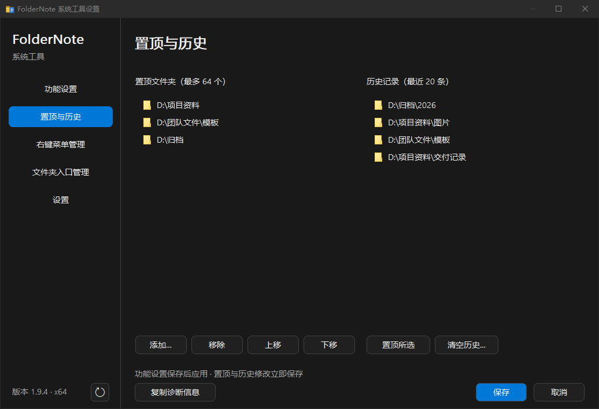

# FolderNote 使用说明

适用于 **FolderNote 1.9.5**。FolderNote 为 Windows 资源管理器提供文件夹入口管理、右键菜单管理、文件夹备注、双击空白处导航、中键快速定位与复制 / 移动，以及 Windows 10 多标签功能。

## 1. 安装与首次使用

### 选择安装方式

目前面向 **Windows 10 / Windows 11 x64**，不提供 ARM64 安装包。

| 系统与安装方式 | 运行文件 | 文件夹备注菜单的位置 |
| --- | --- | --- |
| Windows 10，通用版 | `Install.exe` | 文件夹右键菜单 |
| Windows 11，通用版 | `Install.exe` | 文件夹右键 → 显示更多选项 |
| Windows 11，首层菜单测试版 | `Install-Win11.exe` | 新版右键菜单中的 FolderNote 应用区域，可能合并为子菜单 |

GitHub 发布资产的通用包为 `FolderNote-win-x64.zip`，首层菜单测试包为 `FolderNote-win11-test.zip`。本地构建的压缩包文件名还会带有版本号。

Windows 11 的菜单顺序由系统控制，不能保证 FolderNote 始终紧挨着“属性”。首层菜单测试版目前未签名，供个人测试使用；安装可能受组织策略限制，不能把打包成功视为所有 Windows 11 版本均已验证。现有实机验证环境为 Windows 10 22H2；Windows 11 24H2 / 25H2 仍需对应环境验收。

### 安装步骤

1. 完整解压安装包，不要直接在压缩包中运行，也不要只复制其中一个程序。
2. 通用版运行 **Install.exe**；Windows 11 首层菜单测试版运行 **Install-Win11.exe**。保持包内的程序、扩展文件及应用包在同一目录。
3. 首次安装会请求管理员授权，用于启用资源管理器扩展。Windows 11 首层菜单测试版要求当前账户自身的管理员授权，不支持改用另一个管理员账户安装。
4. 安装后关闭并重新打开需要使用的文件夹窗口。
5. 在开始菜单搜索 **FolderNote 设置**，按需开启功能并点击 **保存**。

程序安装到当前用户的 `%LocalAppData%\Programs\FolderNote`。日常修改功能开关不需要管理员权限。Windows 11 首层菜单版请使用配套安装器，不要只安装 `FolderNote.msix`，否则资源管理器导航组件可能没有一并更新。

### 首次安装的默认状态

| 功能 | 默认状态 |
| --- | --- |
| 右键菜单管理 | 关闭 |
| 文件夹备注 | 关闭 |
| 双击空白处导航 | 开启，返回上一级文件夹 |
| 中键快速定位 | 关闭 |
| 菜单中的复制 / 移动按钮 | 随中键菜单提供，无单独开关 |
| Windows 10 多标签 | 关闭 |
| 始终在新标签中打开文件夹 | 关闭；需要启用 Windows 10 多标签 |
| 外观主题 | 跟随系统 |

“同时支持文件与文件夹选择对话框”默认处于勾选状态，但只有开启“中键快速定位”并保存后才生效。只想在桌面和资源管理器中使用中键菜单时，可以取消这个子选项。

覆盖升级会保留已有选择，不会把使用中的设置重置为首次安装默认值。

## 2. 设置窗口、版本号与主题

从开始菜单搜索 **FolderNote 设置**，或双击 `FolderNote.exe`。也可在 Windows 10 的 FolderNote 标签栏上右键选择 **设置**。中键菜单底部的设置图标会直接打开 **置顶与历史**。

左侧可切换 **功能设置**、**置顶与历史**、**右键菜单管理**、**文件夹入口管理** 和 **设置**。左下角显示当前运行的版本。在 GitHub 发布版中，可点击版本旁的 **检查更新**，确认后由程序下载并校验对应的安装包，再打开安装器。请先保存当前设置。

### 功能设置与外观

在 **功能设置** 中，用每组右侧的开关启用功能。开启 **中键快速定位** 后，可用组内的复选框控制文件与文件夹选择对话框。**双击空白处导航** 的行为通过下拉框选择，鼠标滚轮可继续滚动设置页面。更改开关或选项后，点击 **保存** 应用。切换页面时会保留未保存的选择。

在 **设置** 中可更换界面语言、导出或导入语言模板，并选择 **跟随系统**、**浅色** 或 **深色**。更换主题时会预览效果，保存后应用到设置、备注窗口和中键菜单。系统高对比度模式优先，Windows 自带的文件选择和确认对话框由系统绘制。

### 右键菜单管理

在设置窗口左侧打开 **右键菜单管理**。切换到该页或更改分类时，底部会显示 **正在读取右键菜单…**，读取 Windows 实际菜单时会更新提示。读取失败时，可点击右上角的刷新图标重试。

1. 在左栏选择 **所有文件**、**指定文件扩展名**、**文件夹**、**文件夹空白处**、**驱动器** 或 **桌面空白处**，也可查看 **新建**、**发送到** 和 **打开方式** 子菜单。
2. 在右侧切换 **已有菜单项** 或 **自定义命令**。搜索框可按菜单名称筛选。在 **指定文件扩展名** 分类中，可在搜索框右侧输入 `.pdf` 等后缀，也可点箭头按字母选择。再次点击箭头、点击弹出列表之外或按 Esc 可关闭列表。
3. 在 **已有菜单项** 中点击眼睛图标可隐藏或显示支持的项目，右键条目可查看可用操作。选择有注册来源的条目时，底部会显示对应位置，也可从条目的操作菜单在独立的注册表编辑器窗口打开该位置。

支持的静态菜单项可隐藏或恢复，当前用户注册的静态项还可改名和更换图标。备注功能开启后，可分别控制添加或编辑、清除和修复备注的文件夹菜单项。「发送到」支持隐藏和恢复部分项目。Windows 提供的部分原生命令仅供查看，例如驱动器菜单中的 **还原以前的版本**。条目状态与可用操作以管理页为准。

动态生成的命令按提供这些命令的菜单注册项一起切换。对受支持的全机注册，FolderNote 优先在当前用户范围隐藏对应注册项。通过扩展屏蔽隐藏的项目可能需要重启资源管理器才会更新实际菜单。

**批量还原** 会恢复 FolderNote 已修改的原菜单项。关闭右上角的 **启用右键菜单管理** 开关会尝试还原这些修改，并从资源管理器菜单移除 FolderNote 的自定义命令子菜单。已配置的命令会保留。若其他软件已改过同一注册项，FolderNote 会报告冲突并保留外部变更。

#### 添加自定义命令

1. 先选择命令要出现的分类，再切换到 **自定义命令** 并点击 **添加…**。例如只给 `.pdf` 文件添加命令时，先选 **指定文件扩展名** 并输入 `.pdf`。
2. 输入菜单名称，选择 **程序**、**网址**、**CMD** 或 **PowerShell**，再填写对应的程序路径、参数、网址或命令。需要传入选中对象或文件夹空白处的当前目录时使用 `{path}`，需要其父目录时使用 `{parent}`。
3. 点击 **工作目录** 或 **仅在此文件夹内显示** 右侧的 **选择文件夹**，在系统对话框中选路径。勾选 **包括子文件夹** 可扩大目录筛选范围。点击 **图标位置** 右侧的 **选择图标**，打开 Windows 自带的图标选择窗口。
4. 查看执行预览，点击 **保存**。可用上移和下移调整命令在 FolderNote 子菜单中的顺序。Windows 11 可从资源管理器的 **显示更多选项** 进入经典菜单。

### 文件夹入口管理

在设置窗口左侧打开 **文件夹入口管理**，选择 **此电脑**、**左侧导航栏** 或 **桌面**。

| 位置 | 可管理的入口 |
| --- | --- |
| 此电脑 | 资源管理器将入口分为 **文件夹**、**设备和驱动器** 和 **网络位置**。受支持的系统及软件入口可以调整，实际盘符和网络位置也可在列表中查看。 |
| 左侧导航栏 | 管理独立的导航入口。**快速访问** 内的固定项目仍由资源管理器管理。 |
| 桌面 | 管理受支持的系统图标和指向文件夹的个人快捷方式。共享桌面快捷方式供查看。个人快捷方式使用 Windows 隐藏属性，开启 **显示隐藏的项目** 后仍可见。 |

顶部的两个图标可在 **列表视图** 和 **图标视图** 之间切换。点击组标题左侧的箭头可折叠或展开。「此电脑」优先沿用已打开的同名资源管理器视图中的组内顺序。没有同名视图时，当前可见的入口按 Windows 的排序规则排列。选中项目后，底部状态栏显示名称、状态、来源与可取得的目标路径。快捷方式可显示自身路径，虚拟入口可能只提供系统入口标识。可拖动状态栏上方的分隔线调整高度。

#### 添加、隐藏、还原与移除

- **添加文件夹…** 将所选文件夹添加到当前位置。可从顶部按钮或列表空白处的右键菜单打开文件夹选择窗口。
- **隐藏 / 显示** 切换受支持入口在资源管理器里的可见性。列表视图的眼睛图标、底部状态栏的眼睛图标和条目右键菜单均可操作。已隐藏入口仍留在管理列表，图标会变淡。
- **还原** 恢复该入口在 FolderNote 首次修改前的状态。入口原来处于隐藏状态时，执行还原后仍为隐藏。
- **移除入口** 可撤销 FolderNote 添加的入口。对「此电脑」中受支持的现有入口，该操作会将入口从资源管理器和主列表移走；要重新显示，请点顶部 **已移除**，选中条目后点 **恢复入口**。两种移除操作均保留目标文件夹及内容。

更改即时保存。FolderNote 会刷新已打开的资源管理器视图；视图仍显示旧内容时，可重新打开相关窗口。百度网盘、夸克网盘等软件可能在「此电脑」添加供所有用户使用的入口。若程序提示需要权限，请以管理员身份打开 FolderNote 再操作。移除这类入口会影响对应位置的显示，网盘软件及数据会保留。

运行 `Uninstall.exe` 时，FolderNote 会尝试还原已修改的入口并移除自己添加的入口。

## 3. 文件夹备注

### 开启备注列

1. 在“功能设置”中勾选 **文件夹备注** 并保存。
2. 在资源管理器中打开需要查看的文件夹的**父目录**，切换到 **详细信息** 视图。
3. 右键“名称”等列标题 → **更多** → 勾选 **备注**。

列显示方式由资源管理器按文件夹视图保存，其他目录可能需要另外启用。关闭 FolderNote 的备注功能只会隐藏右键入口，已有备注继续保留。

### 添加、编辑与清除

右键一个文件夹，选择 **添加/编辑备注**。编辑窗口会读出已有内容，按 **Enter** 保存，按 **Esc** 取消。Windows 11 通用版需要先进入“显示更多选项”。

备注为单行，最多 500 个 Unicode 字符；粘贴的换行和制表符会转换为空格，首尾空白会去除。本版不接受以 `@` 开头的备注，因为 Windows 会将其解释为资源引用。

选中一个或多个文件夹后，可通过 **清除备注** 删除备注；确认后执行。此操作保留原有文件夹图标、显示名称及其他自定义配置。

### 复制、移动或解压之后

备注保存在目标文件夹自己的隐藏系统文件 **desktop.ini** 中。复制或移动时，只要这个文件也被带到目标位置，备注内容就能随文件夹保留；压缩、同步或复制工具如果排除了隐藏系统文件，内容便不会跟随过去。

如果文件仍在，只是复制或解压丢失了相关属性，可以这样恢复：

1. 在目标位置选中一个或多个需要恢复的文件夹。
2. 右键 → **修复文件夹备注**。
3. 查看汇总；有失败项时，可以复制失败详情。

修复只处理**所选文件夹本身**，不会递归扫描子文件夹，也不会改写备注内容。

| 结果 | 含义 |
| --- | --- |
| 已恢复 | 找到备注，并恢复了所需属性 |
| 原本正常 | 已有备注及相关属性，无需恢复 |
| 无备注文件 | 未找到 desktop.ini，不会创建空文件 |
| 无备注 | 有 desktop.ini，但没有有效备注 |
| 失败 | 无权限、位置不可用或无法完成操作；其他选中项仍会继续处理 |

**desktop.ini 已被删除时，修复不能找回备注文字。** 需要从原文件夹或备份中恢复该文件。

保存后程序会尝试刷新相关列表。部分网络位置、超长路径或系统缓存状态下，仍可能需要重新进入父目录。只读配置、损坏的备注文件、目录链接、联接点和云占位目录等情况可能无法处理；网络存储能否显示备注还取决于服务器及 Windows 对该位置的支持。收到保存错误时请查看完整提示，尤其是提示中列出的备份位置。

## 4. 双击空白处导航

在“功能设置”中开启 **双击空白处导航**，选择一种行为并保存：

| 选项 | 行为 |
| --- | --- |
| 返回上一级文件夹 | 例如从 `D:\资料\项目` 回到 `D:\资料` |
| 后退到上一次浏览的位置 | 回到资源管理器浏览历史中的上一处位置，不一定是父目录 |
| 取消勾选此功能 | 停止双击导航；再次开启时保留此前选择 |

请在资源管理器**文件列表的空白背景**连续双击。文件、文件夹条目、分组标题、侧边栏、工具栏和滚动条不属于空白区域；拖动或按住 Ctrl、Shift、Alt、Win 时不会触发。

此功能用于 Windows 资源管理器，不用于桌面、打开 / 保存文件对话框或第三方文件管理器。与 QTTabBar 等工具同时开启相同手势可能产生重复导航，建议只保留一个工具处理该手势。

## 5. 中键快速定位

在“功能设置”中勾选 **中键快速定位** 并保存，然后在桌面或资源管理器文件列表中按下鼠标滚轮，也就是鼠标中键，即可打开菜单。桌面支持不依赖文件对话框子选项。

启用后会运行一个随当前用户登录启动的小型后台组件。“始终在新标签中打开文件夹”也复用该组件；两项均停用并保存后，组件退出并移除相关启动项。

### 菜单怎么用

| 操作 | 效果 |
| --- | --- |
| 单击文件夹行 | 在当前窗口跳转到该文件夹；从桌面调用时默认另开窗口，启用新标签选项后优先使用已有窗口的新标签 |
| 悬停文件夹行 | 展开子菜单，可继续浏览子文件夹 |
| 子菜单 → 在新窗口打开 | 另外打开一个资源管理器窗口 |
| 顶部操作行最右侧的置顶图标 | 置顶或取消置顶当前文件夹 |
| 底部设置图标 | 打开“置顶与历史”设置页 |
| 底部清空图标 | 确认后清空访问历史和访问次数，保留置顶文件夹 |
| 点击外部、切换应用或按 Esc | 关闭整组菜单 |

进入二级菜单不会关闭主菜单。菜单也支持键盘：上下键选择、右方向键展开、左方向键返回、Enter 打开位置。列表较长时可以滚动。

在文件列表空白处按中键且没有选中项目时，顶部操作行最左侧显示当前文件夹名称，置顶图标保持在最右侧；长名称会自动省略。有选中项目时，左侧改为“复制”“移动”按钮，数量显示在菜单底部。

文件夹图标使用 Windows 系统图标或文件夹自己的自定义图标。网络或慢速目录的子项可能需要等待；隐藏和系统目录不列入子目录菜单。遇到“更多内容请打开文件夹”提示时，可以直接打开该目录浏览。

### 置顶与历史

从设置左侧打开 **置顶与历史**，可以手动添加一个文件夹，也可在右侧选中历史记录后点 **置顶所选**。左侧选中已置顶的文件夹后可调整顺序或移除。**清空历史…** 会清除访问记录与访问次数，置顶项目会保留。此页修改立即保存。

- 置顶文件夹排在最前，最多 **64 个**。可以在设置中添加、移除、上移和下移，也能从历史中选中一个位置并置顶。
- 将鼠标移到“最近访问”或“最多访问”上即可切换列表。“最近访问”最多显示 **8 个未置顶位置**，“最多访问”最多显示 **10 个未置顶位置**。键盘可用左右方向键选择选项卡，按 Enter 切换。
- “最多访问”按通过快速定位菜单成功使用该文件夹的次数排序，次数相同时优先显示最近使用的文件夹。升级后开始累计次数，未满 10 条时用最近访问的未置顶文件夹补足。
- 点击选项卡列表下方的 **“…”** 可以打开历史记录。
- 历史最多保留 **20 个不同目录**。再次访问同一目录会移到最前，不重复占位。
- 置顶与历史只保存位置记录；移除记录不会删除文件夹。

### 文件与文件夹选择对话框

如需在其他软件的标准打开 / 保存、选择文件夹或旧式“浏览文件夹”对话框中使用，再勾选 **同时支持文件与文件夹选择对话框** 并保存。旧式浏览窗口的经典样式和可调整大小样式均支持。

文件对话框支持复用桌面菜单的后台组件。取消这个子选项后，桌面和资源管理器菜单仍可使用，组件继续运行；只有中键快速定位和新标签接管均停用后才会停止组件。

在支持的打开 / 保存对话框中，选择菜单里的文件夹只切换目录，不自动点击“打开 / 保存”，也不改写文件名。在旧式“浏览文件夹”窗口中，菜单只向原窗口提交目录定位，仍由你点击“确定”。软件若限制可选根目录或过滤某些目录，能否定位仍由该软件决定。

旧式窗口没有可可靠读取的完整地址，FolderNote 不根据树节点文字推测当前路径，因此不会显示“置顶当前文件夹”图标。已有置顶、最近访问和历史记录仍可使用，也可在设置中手动添加置顶。

管理员权限的软件、第三方自绘对话框不在当前支持范围；无法直接定位时，可使用菜单中的“在新窗口打开”。任务栏和普通应用内容区不会弹出该菜单。

资源管理器模式会记录访问过的文件夹；文件对话框主要在调用菜单和跳转时记录位置，不记录每一次浏览。旧式浏览文件夹窗口仅记录通过菜单提交的目标目录，不读取树中每次选中的目录。

1.8.7 已通过真实隐藏的 64 位和 32 位旧式窗口定位测试，覆盖两种样式及中文、空格、Emoji 路径；这不代表所有安装器或自定义选择窗口均已实机验证。

### 复制与移动所选项目

在“功能设置”中开启 **中键快速定位** 后，菜单顶部同一行最左侧提供 **复制** 和 **移动** 文字按钮，最右侧为 **置顶当前文件夹** 图标。下方直接显示置顶列表，不显示分组标题。复制 / 移动无需单独开启，也无需按 Ctrl 或 Shift。

1. 在桌面或资源管理器中选中一个或多个文件、文件夹。
2. 直接单击中键打开菜单。在已选项目上或文件列表空白处点击均可，操作对象为当前窗口中已选中的项目。
3. 菜单底部设置按钮左侧显示“已选 N 项”，没有选中项目时不显示数量。点击顶部的“复制”或“移动”后，该按钮高亮，底部文字变为“复制 / 移动 N 项到…”，菜单保持打开。再点一次同一按钮可取消该模式，恢复快速定位。
4. 单击置顶、历史或常用位置中的目标文件夹即可执行；悬停可展开子目录，子菜单第一项为“复制 / 移动到此文件夹”。

没有选中项目时，复制 / 移动按钮及底部数量文字都隐藏；有选中项目时，即使从空白处打开菜单也会显示。来源为桌面或资源管理器当前文件列表的选择，文件选择对话框不提供这些操作。“此电脑”“回收站”等虚拟项目不支持复制 / 移动，相关按钮会禁用；标签栏中键仍用于关闭标签。Ctrl / Shift＋中键不再触发复制 / 移动。

菜单保留弹出时的整组选中项目，点击目标目录不会跳转原窗口。操作使用 Windows 自带的复制 / 移动功能，显示系统进度与重名冲突提示，并可在系统窗口中取消；非常小的任务可能完成得很快，进度窗口不一定来得及显示。移动会将原项目移到目标目录，复制会保留原项目。此功能不改写剪贴板。

## 6. Windows 10 多标签

Windows 10 中可开启 **资源管理器多标签（Windows 10）** 并保存。标签栏由软件开关控制，不需要到资源管理器“查看 → 选项”中勾选工具栏。Windows 11 使用系统原生标签，不提供此自定义标签栏开关。

| 操作 | 效果 |
| --- | --- |
| 单击标签 | 切换到该标签保存的文件夹 |
| 单击标签栏空白处 | 复制当前文件夹为新标签，并切换过去 |
| 悬停标签 | 显示完整路径提示及该标签的关闭按钮 |
| 单击悬停时出现的关闭按钮 | 关闭对应标签 |
| 在标签上按中键 | 关闭对应标签，无需先选中它 |
| 在标签上向上滚轮 | 切换到上一个标签 |
| 在标签上向下滚轮 | 切换到下一个标签 |
| 右侧下拉按钮 | 选择未在当前标签栏中显示的标签 |
| 右键标签或标签栏 | 新建、复制、关闭、恢复标签，复制路径，或打开设置；还可选择“在新窗口打开” |
| 将文件或文件夹拖到标签上 | 把项目交给该标签对应的文件夹，使用 Windows 的拖放规则 |

右键 **新建标签** 打开“此电脑”；右键 **复制标签** 使用所点标签的目录。标签栏没有“＋”按钮，关闭按钮在未悬停时隐藏。鼠标在文件列表内按中键仍用于快速定位，在标签上按中键则用于关闭标签。

### 始终在新标签中打开文件夹

先开启 **资源管理器多标签（Windows 10）**，再勾选其下方的 **始终在新标签中打开文件夹** 并保存。这个子选项默认关闭；关闭多标签时暂时停用，但保留之前的勾选状态。此功能仅支持 FolderNote 的 Windows 10 自定义标签，不接管 Windows 11 原生标签。

开启后，桌面双击文件夹、其他软件打开文件夹，以及 FolderNote 打开目录时，会优先在已有资源管理器窗口中新建标签。尚无可用窗口时仍正常打开首个窗口；启用前已经打开的窗口不会自动合并。

外部程序打开目录时，扩展在窗口创建阶段暂缓新窗口显示，并把目录交给已有窗口的新标签。确认目录加载后完成交接；首个窗口、加载失败或超时会正常显示来源窗口。升级后须加载新版扩展；如果扩展直到窗口已显示后才附着，则不会强制隐藏该窗口。

需要单独窗口时，在标签上右键选择 **在新窗口打开**。它使用所点标签的目录，保留原标签，并且不受“始终在新标签中打开文件夹”选项影响。此选项需要的小型后台组件与中键菜单共用，不必同时开启中键菜单。

### 标签切换和关闭

滚轮到首尾后停止，不循环。连续滚动会合并为最终要切换的位置；若目录仍在加载，会等待当前跳转结束后继续。滚轮在标签栏外保留正常滚动行为。中键需要在同一标签上按下并松开，拖动经过标签或从其他区域移入松开不会关闭它。

每个窗口最多 **32 个标签**，保留该窗口最近 **20 个关闭记录**。最后一个标签不会被关闭，也不会借此关闭资源管理器。标签栏获得键盘焦点时，**Ctrl+T** 新建标签，**Ctrl+W** 关闭当前标签。

各标签保存自己的当前目录；资源管理器的前进 / 后退历史仍由窗口共享。关闭整个窗口后，当前版本不会自动恢复这组标签。

### 拖入标签

先打开目标文件夹的标签，再从当前文件列表、另一个资源管理器窗口或桌面拖动文件或文件夹。指针移到目标标签上时，接受拖放的标签会高亮。松开鼠标后，Windows 根据来源、目标及所按修饰键决定复制、移动或创建快捷方式。可用 **Ctrl** 请求复制，或用 **Shift** 请求移动，以鼠标指针显示的操作为准。目标文件夹支持拖放时，可以直接投放到后台标签，当前标签会留在原处。

## 7. 升级与卸载

### 覆盖升级

完整解压新版安装包，再运行对应安装器即可覆盖升级，通常不需要先卸载，也不需要注销。已有功能开关、主题、置顶与历史会保留。

安装器会避开仍被资源管理器占用的旧程序文件，但**安装完成不等于所有已打开的窗口已经换成新版**。旧窗口可能继续使用旧扩展：

1. 先确认设置窗口左下角显示的是新版本；升级前已打开的设置窗口可能仍显示旧版本，可以关闭后重新打开。
2. 关闭并重新打开需要使用新版功能的文件夹窗口。
3. 如果仍使用旧扩展，先结束文件复制或移动，再重启资源管理器。重启会关闭文件夹窗口，并让桌面和任务栏短暂刷新。

安装器不会强制重启资源管理器。Windows 11 首层菜单测试版应运行 `Install-Win11.exe` 完整升级，不要只更新应用包。

### 完整卸载

运行 **Uninstall.exe**，或从 Windows 的“应用和功能 / 已安装的应用”中找到 FolderNote 并选择卸载。确认后会移除当前用户的菜单与程序组件，停止中键后台组件，并清理本工具的启动项。移除扩展自动加载入口可能需要管理员授权。

卸载保留文件夹中的 `desktop.ini` 备注，也保留当前用户的设置、置顶和历史，便于重新安装后继续使用。如果希望清空历史，可在卸载前到“置顶与历史”页执行。卸载不会遍历用户文件夹，也不会删除安装目录中的未知文件。

如果卸载报告仍有文件被占用，关闭相关窗口后可以再次运行卸载工具。Windows 11 首层菜单版也应使用 **Uninstall.exe**；只在系统中删除应用包，可能留有独立的导航组件。

## 8. 常见问题

### 找不到设置入口或备注菜单

从开始菜单搜索 **FolderNote 设置**，不必依赖右键入口。首次安装默认关闭文件夹备注，开启并保存后才显示备注命令。Windows 11 通用版的备注入口位于“显示更多选项”；首层菜单测试版则可能位于 FolderNote 子菜单中。

### 备注保存了，但列表没有显示

先确认已在目标文件夹的父目录启用“详细信息 → 备注”列。可以重新进入该父目录，或对目标文件夹执行“修复文件夹备注”。若结果为“无备注文件”，检查复制、压缩或同步时是否遗漏了 desktop.ini；若为“原本正常”但仍不显示，可能与资源管理器缓存、网络位置或系统对该文件的信任有关，属性修复不能保证解决所有情况。

### 双击空白处没有反应

确认功能已勾选并保存，在文件列表的空白处双击，并松开修饰键。新安装或升级后重新打开文件夹窗口。企业策略可能限制扩展加载；同时启用的其他手势工具也可能发生冲突。

### 中键菜单不弹出

确认“中键快速定位”已开启并保存。在文件或文件夹选择对话框中使用时，还需开启“同时支持文件与文件夹选择对话框”。旧式“浏览文件夹”支持从 1.8.7 开始，先检查设置左下角版本号。尝试在普通资源管理器窗口内按下并松开中键，避免拖动或按住修饰键。标签上的中键用于关闭标签，不会弹出菜单；管理员软件或自绘文件对话框可能不受支持。升级后的旧窗口可先关闭再重新打开。

### 已开启多标签，但没有标签栏或新操作不起作用

这个开关只用于 Windows 10。确认已经点击 **保存**，再重新打开文件夹窗口。刚升级时，旧窗口可能仍加载旧版扩展。拖动项目时，如果目标标签没有高亮，可以先检查该标签对应的位置是否接受资源管理器的文件拖放。

### 为什么还会有 FolderNote 后台进程

开启“中键快速定位”时，需要一个小型后台组件处理桌面中键。“始终在新标签中打开文件夹”也需要并复用该组件。取消文件对话框子选项不会停止桌面支持；中键快速定位和新标签接管均停用并保存后，组件才会退出。备注、设置或中键菜单正在显示时，也会有对应程序运行；它们关闭后会退出。软件不设托盘图标。

### 如何反馈问题

在设置中点击 **复制诊断信息**，并记录 Windows 版本、FolderNote 版本、出问题的操作和是否每次都会发生。诊断信息有助于区分功能未开启、扩展未加载、旧版本仍被使用等情况；对偶发问题，说明最近进行过的切换、复制或升级操作也有帮助。

FolderNote 的设置、置顶与历史保存在本机当前用户配置中，不上传。文件夹备注保存在文件夹自身，备份文件夹时请一并保留 desktop.ini。
